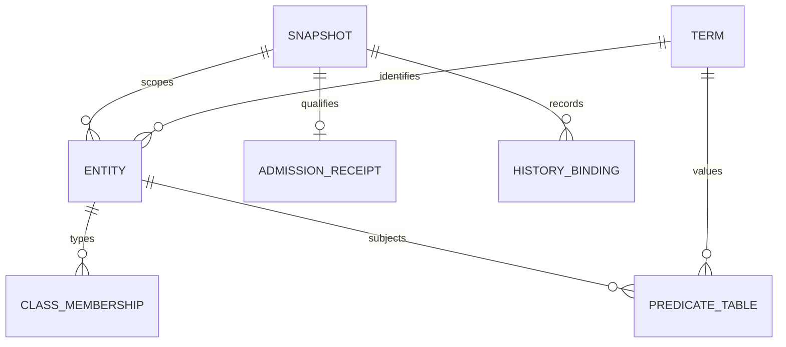

# Physical projection architecture

The full foreign-key inventory is [physical-foreign-keys.csv](physical-foreign-keys.csv); every table, view and column is in [data-dictionary.csv](data-dictionary.csv). This diagram shows representative physical patterns, not all hundreds of tables.

The native-to-class and relation-to-predicate mappings are explicit source CSV files. A physical predicate table may represent an inverse or retained profile helper; its count is not an independent association count. The occurrence profile adds append-only provenance and binding controls to the retained 438-table schema and two base admission tables. Record keys do not prove real-world identity.
