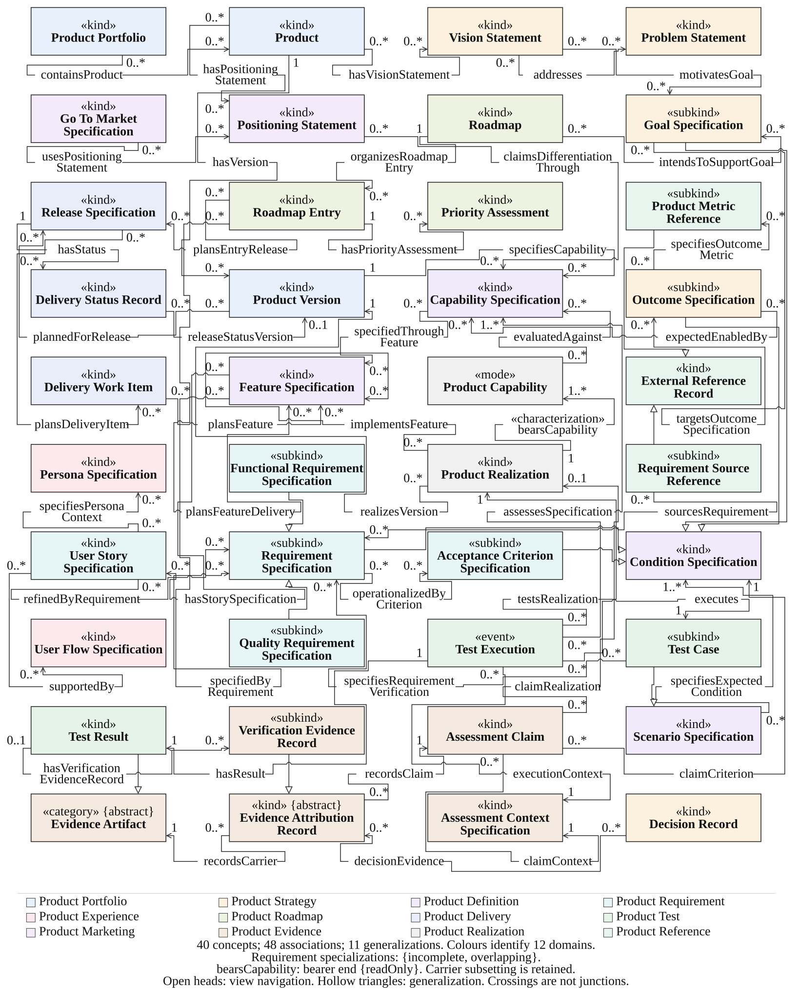
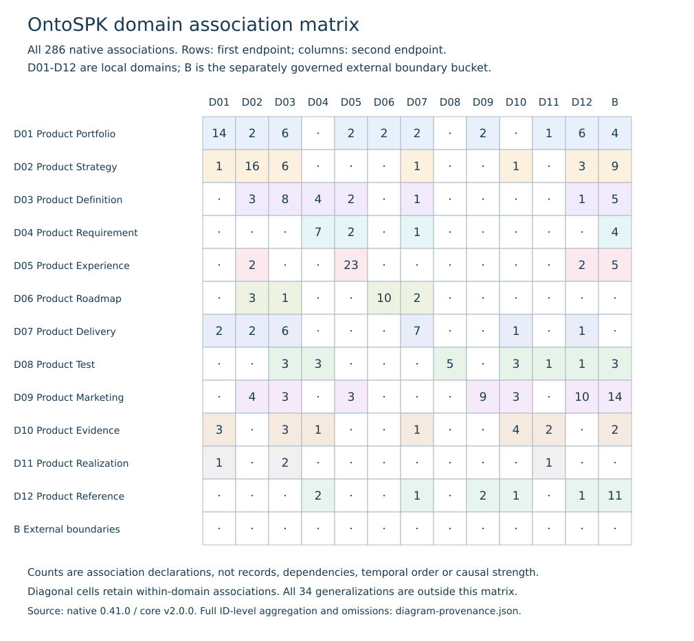
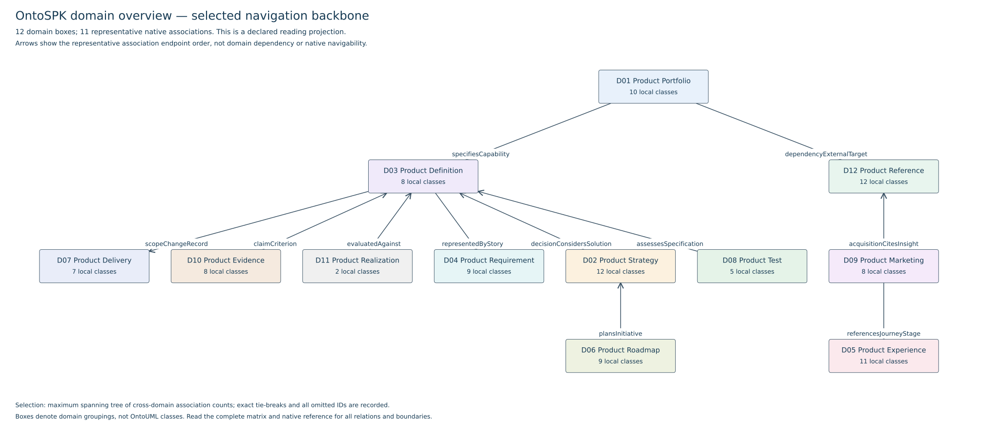

# Diagrams, domains and source traceability

The selected conceptual figure and the two domain views are reading projections of the unchanged OntoSPK core v2.0.0. They serve different purposes and retain explicit source bindings and omissions. The complete [native reference](../../semantic/product/v2/reference/README.md), rather than a simplified picture, remains the route to all model elements.

## Selected conceptual view



[Open the reviewed SVG](../assets/diagrams/selected-reviewed.svg). This view displays 40 classes, 48 associations and 11 generalizations from the full native source of 128 classes, 286 associations and 34 generalizations. Names, stereotypes, endpoint cardinalities and arrow target boundaries are checked against the exact current native records. Omitted identifiers are enumerated in the [machine-readable review](../../evaluation/diagram-provenance.json).

Association heads are open and explicitly express a selected-view navigation convention. The native model does not assert this navigability. Hollow generalization triangles point to the general class. Plain associations are not assigned invented relation stereotypes. The review does not settle full UFO conformity or the separate ProductCapability profile question (#48).

## Historical discrepancies

The historical selected-view manifest retains six null isReadOnly values where the current native endpoints and SVG metadata say true. All six current endpoint records are supplied by the review; the historical file remains unchanged. Some endpoint annotations are not visibly printed in this selected figure.

The original SVG description claims embedded draw.io data, but its XML contains no such payload. The reviewed presentation copy removes that unsupported claim and retains the visible geometry. An editable source has not been recovered. Its physical size is 178 by 222.5 mm with a portrait viewBox, suitable as an article figure rather than a complete A4 sheet.

## Complete domain association matrix



[SVG](../assets/diagrams/domain-matrix.svg) · [PNG](../assets/diagrams/domain-matrix.png)

The matrix accounts for all 286 native association declarations. Rows are first endpoints and columns are second endpoints; diagonal cells retain within-domain links. The twelve domain colors are taken from the selected figure. The external-boundary bucket groups 27 separately governed handles and is not a thirteenth domain. The matrix is a source inventory, not a claim about dependency direction, chronology or causal strength. Generalizations have their own semantics and are excluded from these counts.

## Simple rectangle-and-arrow view



[SVG](../assets/diagrams/domain-backbone.svg) · [PNG](../assets/diagrams/domain-backbone.png)

This deliberately sparse overview connects the twelve local domains through eleven representative native associations. A deterministic maximum spanning tree selects domain pairs using the number of cross-domain association declarations; ties use domain names. One representative relation per pair is selected by native identifier. The displayed name and arrow orientation follow that exact relation's native endpoints. Boxes denote domain groupings, not OntoUML classes. The arrows do not add native navigability or imply dependency.

Every selected relation, its endpoint classes and cardinalities, the complete pair matrix, and all 275 associations omitted from this sparse overview are in the [review data](../../evaluation/diagram-provenance.json). This is a new source-derived realization of the two requested viewing approaches; it does not claim recovery of unlocated earlier exports or an independently approved domain ontology.

## Verification and reproduction

The [full review](../../evaluation/diagram-provenance.md) records exact native/SVG/manifest hashes, all 59 displayed relation bindings, six historical metadata discrepancies and the selected view's omitted 88 classes, 238 associations and 23 generalizations. Six injected faults test cardinality, stereotype, source boundary and head/target checks. Both ends of every displayed relation meet their intended class boundaries. The current reviewed SVG changes only presentation metadata and description; the frozen model, original figure and historical manifest are preserved.

```bash
python tools/publication/build_diagram_review.py
python tools/publication/test_diagram_review.py
```

For explicit PNG refresh, install `tools/publication/diagram-requirements.txt` and add `--render-png` to the builder. PNG metadata binds each raster to its source SVG hash; font rasterization may differ across platforms. CI regenerates vector views and verifies existing raster source bindings. Source reconciliation and visual inspection do not establish independent expert acceptance or full semantic correctness.
