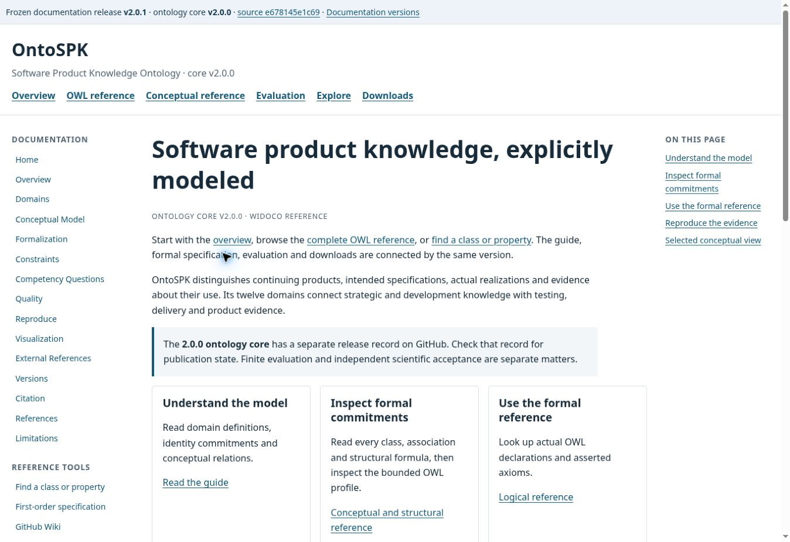
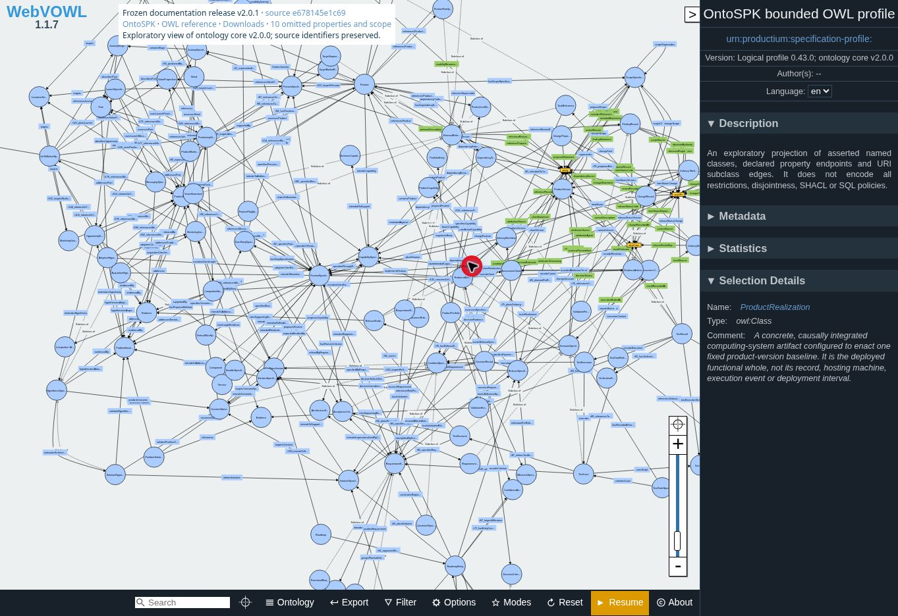

# Live Pages and WebVOWL publication verification

OntoSPK documentation v2.0.1 is published on [GitHub Pages](https://arazsaiearasi3.github.io/OntoSPK/). The [frozen documentation route](https://arazsaiearasi3.github.io/OntoSPK/releases/v2.0.1/index.html) describes ontology core **v2.0.0**. The [current route](https://arazsaiearasi3.github.io/OntoSPK/current/index.html) is explicitly mutable.

The frozen documentation source is `e678145e1c69aca65e87e4875b109bfca07e4648`. The accepted runtime deployment is `4564169a4a01e9f87909578e0c4f2c559ee7a8c1`, deployed by [run 39822912779](https://github.com/ArazSaieArasi3/OntoSPK/actions/runs/39822912779) after [documentation CI 39820926626](https://github.com/ArazSaieArasi3/OntoSPK/actions/runs/39820926626). This receipt was recorded on 22 October 2026. The later public release tag identifies the closeout commit containing this report.

| Check | Observed result |
| --- | --- |
| Reader pages | All 41 rendered with English language, main landmark, primary navigation and frozen source metadata; these include all 15 guide pages |
| Conceptual reference | 128 native class/handle entries, 286 associations, 34 generalizations and 22 scoped commitments; first-order transcription and projection are separately available |
| OWL reference | 121 named classes, 286 object properties and 46 datatype properties; a bare property omitted by WIDOCO is explicitly retained without inventing a definition |
| Term search | 581 entries; ProductRealization yields distinct native and OWL entries; the native result opens its expected anchor; an absent term gives zero matches |
| WIDOCO navigation | An external-boundary URN anchor opens correctly and survives reload without a selector failure |
| Downloads | Four RDF serializations are graph-isomorphic to the released logical source; served bytes match the recorded deployment hashes |
| Figure | The selected conceptual SVG loads and has descriptive alternative text; its stated scope is forty selected concepts |
| Version routes | Current and frozen routes display separate documentation/core labels and source commits; the version selector connects them |
| Snapshot protection | Four checks cover registered snapshots, immutable mappings, changed documentation trees and changed semantic sources |
| HTTP payload | All 228 served files reconcile with the deployment manifest: an initial 228-file readback followed by 45 changed-file fetches and 183 unchanged-hash reconciliations |
| Publication boundary | Native and logical digests remain those of v2.0.0; the Wiki source is unchanged; no physical database payload is added |

## WebVOWL acceptance

Both the [embedded explorer](https://arazsaiearasi3.github.io/OntoSPK/releases/v2.0.1/explore/index.html) and [full-size viewer](https://arazsaiearasi3.github.io/OntoSPK/releases/v2.0.1/webvowl/index.html#ontospk) load a labelled graph. Browser testing found an initialization failure caused by removing two controls that the pinned WebVOWL 1.1.7 runtime reads even in view mode. PR #42 retains inert hidden controls and hides the unavailable editing option. The publication manifest records this presentation adjustment; the frozen source mapping, RDF and graph JSON remain unchanged.

The viewer can automatically collapse elements for readability. Search found ProductRealization and reported that it was filtered. Opening **Filter**, setting **Degree of collapsing** to **0**, and selecting the class displayed its source definition and `urn:productium:specification-profile:ProductRealization` IRI. **Pause** changed to **Resume**, and the viewer's **Downloads** link opened the correct source-download page. The complete term catalogue remains available while elements are collapsed. Display filtering does not change the ten-property adapter omission register.

The automatic deployment remained queued without starting. One manual dispatch of the same CI-accepted commit completed successfully. A local execution of the actual upstream view-mode getter reproduced the original null dereference and passed with the retained controls.

## Evidence and limits

The [machine-readable receipt](pages-publication-verification.json) contains all 41 page observations, per-file HTTP hashes, source identities and the selected-class readback. Three `.nojekyll` control files are excluded from public HTTP readback. One transient HTTP 503 on the initial payload readback succeeded on one retry.

These checks used the observed desktop viewport and basic document landmarks; they are not a full accessibility certification. Rendered acceptance and finite evaluation do not establish independent ontology correctness. Expanded scientific evaluation remains in #16–#22. Individual sourced concept pages remain deferred in #37; pyLODE is not implemented.

